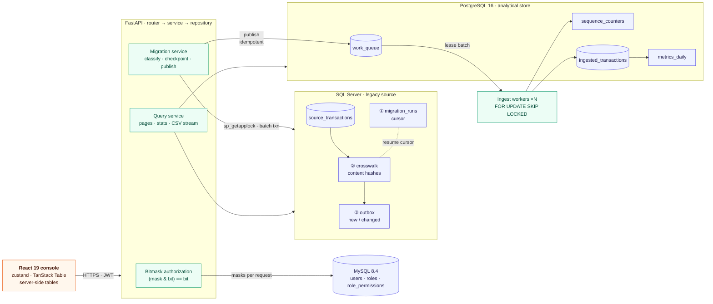

# OmniData Analytics & Sync Platform

**Three database engines, one pipeline: resumable migration, queue processing without lock contention, and bitmask access control, built on React 19, FastAPI, PostgreSQL 16, MySQL 8.4 and SQL Server.**

OmniData moves transactional data out of a legacy SQL Server source, classifies every row as new, changed or unchanged, hands it to a PostgreSQL work queue consumed by horizontally scalable workers, and exposes the result through an operations console. Each engine does the job it is best at, and every cross-engine hand-off is designed to be **idempotent and restartable**.

> The domain is fully synthetic (`users`, `transactions`, `sync_logs`, `metrics`). The repository contains no data, schemas or code from any commercial system.

| | |
|---|---|
| **Backend** | Python 3.12 · FastAPI · SQLAlchemy 2 (three independent connection pools) · Pydantic v2 |
| **Databases** | SQL Server 2022 Express · PostgreSQL 16 · MySQL 8.4 |
| **Frontend** | React 19 · TypeScript (strict) · Vite 6 · zustand · TanStack Table |
| **Delivery** | Docker Compose · nginx · non-root containers · loopback-only published ports |
| **Quality** | 47 backend tests · 4 frontend tests · state-machine linter · strict type-check in the build |

---

## 1. Key architectural features

### Microsoft SQL Server: the legacy source and the migration engine

Code: [`migration_service.py`](backend/app/services/migration_service.py) · [`mssql_repo.py`](backend/app/repositories/mssql_repo.py) · [`001_source_and_sync.sql`](db/mssql/001_source_and_sync.sql)

- **Resumable, three-layer migration state.**
  1. `sync.migration_runs`: a durable cursor per run.
  2. `sync.crosswalk`: the last-seen SHA-256 content hash per source row.
  3. `sync.outbox`: only new and changed rows, ready to publish.

  Each batch commits its crosswalk updates, outbox rows **and** the advanced cursor in one transaction, so a crash resumes exactly after the last fully applied batch. A failed run is picked up and continued, not restarted.
- **Cross-process concurrency control.** A session-scoped `sp_getapplock` guarantees a single active migration across every API replica that shares the SQL Server instance. A second caller receives a clean `409 Conflict` instead of corrupting the cursor.
- **Atomic identifier capture.** New runs are created with `INSERT … OUTPUT inserted.run_id`, returning the generated key in the same statement with no read-after-write race.
- **Lock-friendly publishing.** The outbox is read with `UPDLOCK, READPAST, ROWLOCK`, so concurrent publishers skip rows another publisher already holds.
- **Stale run recovery.** A sweeper marks runs that stopped making progress as `failed`, which makes them resumable.
- **Idempotent DDL.** Every object in the setup script is guarded, so it is safe to re-run.

### PostgreSQL 16: the analytical queue and ingestion store

Code: [`postgres_repo.py`](backend/app/repositories/postgres_repo.py) · [`ingestion_service.py`](backend/app/services/ingestion_service.py) · [`ingest_worker.py`](backend/app/workers/ingest_worker.py) · [`001_schema.sql`](db/postgres/001_schema.sql)

- **Work queue with `FOR UPDATE SKIP LOCKED`.** Workers lease disjoint batches without ever blocking one another, so throughput scales by adding replicas (`docker compose up --scale worker=3`).
- **Life cycle.** `queued → processing → done`, with exponential back-off on failure (5 s doubling, capped at 5 min), a `dead` letter state after the configured attempts, and a sweeper that returns expired leases to `queued`. A worker that lost its lease cannot mark an item done (`LeaseLostError`).
- **Atomic per-period sequence counters.** `INSERT … ON CONFLICT DO UPDATE … RETURNING` allocates numbers like `TX-20260115-000042`. The counter is incremented inside the same transaction that consumes it, so a rollback leaves **no gaps**.
- **Ordering safety.** An upsert guard (`last_queue_id`) ensures a stale queue item can never overwrite a newer version of the same row.
- **Idempotent hand-off.** `UNIQUE (source_id, content_hash)` plus `ON CONFLICT DO NOTHING` turns an at-least-once publish into an exactly-once effect.
- **Indexes.** Partial indexes (`WHERE status = 'queued'`, `WHERE status = 'processing'`) keep the claim path small as completed rows accumulate. Daily aggregates are rebuilt for only the days a batch touched.
- **Bounded memory use.** CSV export streams through a server-side cursor with a hard row cap, and neutralises spreadsheet formula injection.

### MySQL 8.4: resource-based access control

Code: [`permissions.py`](backend/app/core/permissions.py) · [`deps.py`](backend/app/api/deps.py) · [`db/mysql/`](db/mysql)

- **Bitmask authorization.** `ACTION_BITS` defines `read=1, create=2, update=4, delete=8, export=16`. A role stores **one integer per resource**, and a check is a single bitwise AND: `(mask & bit) == bit`.
  ```python
  @router.post("/sync/migrate",
               dependencies=[Depends(require_permission(Resource.SYNC, Action.CREATE))])
  ```
- **Permissions read on every request.** Masks are read from MySQL on every request, so changing a role or deactivating a user takes effect immediately, with no stale token claims.
- **Clear denials.** A `403` states the missing action and what the caller does hold.
- **Idempotent dynamic SQL migrations.** `002_users_extra_columns.sql` checks `information_schema`, builds the DDL string only when the change is missing, and runs it through `PREPARE / EXECUTE / DEALLOCATE PREPARE`. MySQL has no `ADD COLUMN IF NOT EXISTS`, so this is what makes re-runs a no-op. Seeds use upserts, and a test verifies that the SQL seed masks match the Python bits.

| Role | transactions | sync | metrics | users |
|---|---|---|---|---|
| `admin` | R C U D E | R C U D E | R C U D E | R C U D E |
| `operator` | R | R C U | R | none |
| `analyst` | R E | R | R E | none |
| `viewer` | R | R | R | none |

### Frontend: React 19 operations console

Code: [`DataTable.tsx`](frontend/src/components/DataTable.tsx) · [`store/`](frontend/src/store)

- **Single-page architecture** on React 19, TypeScript in strict mode and Vite, served by nginx with a restrictive CSP, with same-origin API proxying in production (no CORS surface).
- **Small global state with `zustand`.** Two small stores: `auth` (session in `sessionStorage`, bitmask helper that mirrors the server check to hide controls) and `sync` (cross-database statistics, the running pipeline step, and a refresh signal that makes every table refetch after an operation).
- **One generic `DataTable<T>` on TanStack Table** with fully **server-side pagination, sorting and filtering**: debounced filters, automatic page reset on filter or sort change, in-flight request cancellation so stale responses can never render out of order, recovery when the data shrinks under the current page, and accessible markup (`aria-sort`, table caption, live result counts). The same component powers the transactions, work-queue and migration-run screens, and CSV export reuses the active filters.
- **Dependency-light visuals:** a hand-written accessible SVG chart, light and dark themes, and responsive layout.

> **A note on Node.js:** the frontend is built and tested with Node 22 tooling (Vite, Vitest, TypeScript). The runtime services are Python; there is no Node.js server in this repository.

---

## 2. System architecture



**Flow:** the console calls FastAPI with a JWT. Every protected route first resolves the caller's permission masks from MySQL. A migration reads the SQL Server source in batches, classifies rows against the crosswalk and writes the outbox, then publishes them idempotently into the PostgreSQL queue. Any number of workers lease rows with `SKIP LOCKED`, allocate gap-free numbers, upsert transactions and rebuild the affected daily metrics. The console reads statistics and tables back through the query service.

---

## 3. Testing & reliability

**47 automated backend tests** (`pytest`) and 4 frontend tests (`vitest`), plus a strict TypeScript type-check and production build.

| Area | What is verified |
|---|---|
| Bitmask authorization | Bit values, combinations, empty masks, denial messages, and that the seeded SQL masks match the Python `Action` bits |
| API authorization | `401` without a token; `403` for missing, wrong-resource and partial masks on every guarded route |
| Sync logic | Normalisation, hashing, new/changed/unchanged classification, and that **replaying a batch after a crash produces no new outbox rows** |
| Security | scrypt hashing and salting, malformed hashes, token round-trip, tampering and expiry |
| State machines | Reachability, dead ends, missing sweepers, unresolved actors, and drift between the declared states and the SQL `CHECK` constraints |
| Query safety | Sort columns only from an allow-list; LIKE wildcards escaped |
| **Transaction boundaries** | See below |

**[`test_transaction_boundaries.py`](backend/tests/test_transaction_boundaries.py)** protects the worker against connection starvation and dangling sessions. It verifies that:

- a queue **claim commits and closes its session before any item is processed**, so no pooled connection or row lock is held while work runs;
- each item is processed in its **own single session**, and nothing is left open afterwards;
- a failure **rolls back and closes** the item's session, and the retry is recorded in a **fresh** one;
- `session_scope` commits on success, rolls back on error and always releases the connection.

These tests assert the transaction *ordering* contract deterministically (using a recording persistence layer and an in-memory engine); they are not a load test.

**State-machine linter.** `python backend/scripts/lint_state_machines.py` validates the work-queue, migration-run and outbox state machines against both the repository code and the SQL schema, and exits non-zero on any violation, so it can gate CI.

```bash
cd backend  && pip install -r requirements-dev.txt && pytest
cd frontend && npm install && npm test && npm run build
```

> **Verification status:** the unit tests, linter, type-check and frontend build run without any database. The SQL scripts and the full Docker Compose stack are **not yet exercised in an automated integration run**; add one before relying on them in production.

---

## 4. Known demo boundaries

The project is designed to show architecture, not to be deployed unchanged. For demonstration purposes:

- **No token revocation.** Access tokens are valid until they expire (default 60 minutes). Disabling a user does block them on their next request, because permissions are re-read from MySQL.
- **No refresh-token rotation.** There is a single short-lived access token per sign-in.
- **No login rate limiting or lockout.** Failed attempts are counted per account but not throttled.
- **Seeded demo accounts.** On first start, four accounts (`admin@`, `operator@`, `analyst@`, `viewer@omnidata.example`) are created with the password you set as `DEMO_PASSWORD`. The stack refuses to start without it, and there are no built-in default credentials.
- **Single JWT signing key**, supplied through the environment.

Before production use, add rate limiting, refresh rotation with revocation, per-user credentials with an identity provider, secret management, and TLS termination.

---

## 5. Quick start (Docker Compose)

**Prerequisites:** Docker with Compose v2 and roughly 3 GB of free RAM (SQL Server is the heaviest container).

```bash
cd docker
cp .env.example .env
```

Open `docker/.env` and fill in **every** variable. Compose will refuse to start if any is missing.

| Variable | Requirement |
|---|---|
| `JWT_SECRET` | 32+ characters |
| `DEMO_PASSWORD` | 12+ characters; shared by the four demo accounts |
| `MSSQL_SA_PASSWORD` | SQL Server complexity rules: 8+ characters with upper, lower, digit and symbol |
| `POSTGRES_PASSWORD`, `MYSQL_PASSWORD`, `MYSQL_ROOT_PASSWORD` | Any strong value |

Generate strong values with `python -c "import secrets; print(secrets.token_urlsafe(36))"`.

```bash
docker compose up --build
```

| Service | URL |
|---|---|
| Operations console | <http://localhost:8080> |
| API and interactive docs | <http://localhost:8000/docs> |
| Health check | <http://localhost:8000/api/health> |

All ports are published on `127.0.0.1` only. Sign in as `admin@omnidata.example` with your `DEMO_PASSWORD`, then use the **Pipeline** card on the overview page in order: *simulate source changes → run migration → publish outbox → process queue*. Sign in as `viewer@` to see the same screens with the write controls disabled.

Scale the queue consumers, or re-run a migration script safely:

```bash
docker compose up --scale worker=3
docker compose exec -T mysql sh -c 'mysql -uroot -p"$MYSQL_ROOT_PASSWORD" omnidata_auth' \
  < ../db/mysql/002_users_extra_columns.sql
```

### Local development

```bash
docker compose -f docker/docker-compose.yml up postgres mysql mssql mssql-init   # databases only

cd backend && python -m venv .venv && . .venv/bin/activate      # Windows: .venv\Scripts\activate
pip install -r requirements-dev.txt
cp .env.example .env      # fill in secrets
uvicorn app.main:app --reload

cd ../frontend && npm install && npm run dev                       # http://localhost:5173, proxies /api
```

---

## API reference

| Method and path | Requires |
|---|---|
| `POST /api/v1/auth/login` · `GET /api/v1/auth/me` | none · valid token |
| `GET /api/v1/stats/overview` | metrics: read |
| `GET /api/v1/transactions`: `page, page_size (≤100), sort_by, sort_dir, search, currency, status, min_amount_cents, max_amount_cents, occurred_from, occurred_to` | transactions: read |
| `GET /api/v1/transactions/export`: same filters, streamed CSV | transactions: export |
| `GET /api/v1/sync/runs` · `GET /api/v1/sync/queue` | sync: read |
| `POST /api/v1/sync/migrate` | sync: create |
| `POST /api/v1/sync/publish` · `/sync/simulate` · `/sync/ingest` | sync: update |
| `GET /api/v1/users` · `DELETE /api/v1/users/{id}` (deactivate) | users: read · users: delete |
| `GET /api/health` | none |

## Repository layout

```text
backend/    FastAPI app (routes → services → repositories), ingestion worker, tests, state-machine linter
frontend/   React 19 + TypeScript + Vite console
db/         Idempotent SQL for SQL Server, PostgreSQL and MySQL
docker/     Compose file, Dockerfiles, nginx config, .env.example
```
