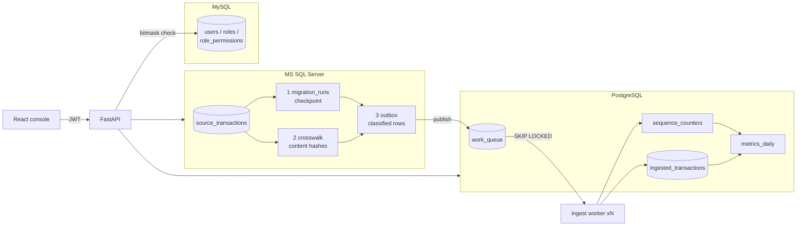

# OmniData Analytics & Sync Platform

A reference full-stack project that keeps **three database engines** in sync and exposes the result through a **React 19** admin console, a **FastAPI** backend and a background worker.

| Engine | Role in the system |
|---|---|
| **MS SQL Server** (Express) | Mock transactional *source* + durable, resumable migration state |
| **PostgreSQL 16** | Analytical ingestion: atomic counters, `SKIP LOCKED` work queue, aggregates |
| **MySQL 8** | Access control with bitmask CRUD permissions |

All data is synthetic and every name is generic (`users`, `transactions`, `sync_logs`, `metrics`).



## Quick start

```bash
cd docker
cp .env.example .env        # fill in every value (see comments in the file)
docker compose up --build
```

* Console: <http://localhost:8080> — sign in as `admin@omnidata.example` (or `operator@`, `analyst@`, `viewer@`) with your `DEMO_PASSWORD`
* API docs: <http://localhost:8000/docs>
* Walk through the **Pipeline** card on the overview page: *simulate → migrate → publish → process*.

Scale the consumers: `docker compose up --scale worker=3` — replicas claim disjoint rows.

### Local development without containers for the app

```bash
# databases only
docker compose -f docker/docker-compose.yml up postgres mysql mssql mssql-init

cd backend && python -m venv .venv && . .venv/bin/activate   # Windows: .venv\Scripts\activate
pip install -r requirements-dev.txt
cp .env.example .env        # fill in secrets
uvicorn app.main:app --reload

cd ../frontend && npm install && npm run dev                  # http://localhost:5173 (proxies /api)
```

## Patterns demonstrated

### MS SQL — resumable three-layer migration
`backend/app/services/migration_service.py`, `repositories/mssql_repo.py`, `db/mssql/001_source_and_sync.sql`

| Layer | Table | Purpose |
|---|---|---|
| 1 | `sync.migration_runs` | Durable cursor. Updated **in the same transaction** as each batch, so a crash resumes exactly after the last fully applied batch. |
| 2 | `sync.crosswalk` | `source_id → content_hash`. Lets a fresh run classify every row as *new*, *changed* or *unchanged*. |
| 3 | `sync.outbox` | Only new/changed rows, ready to publish; `UNIQUE (source_id, content_hash)` as a safety net. |

* Single runner enforced with `sp_getapplock` (second caller → HTTP 409).
* Hand-off to PostgreSQL is **at-least-once and idempotent**: publish, then mark published; a retry is absorbed by `ON CONFLICT DO NOTHING`.
* Pure classification logic lives in `domain/sync_logic.py` and is unit-tested, including "replaying a batch after a crash is a no-op".

### PostgreSQL — atomic counters and a `SKIP LOCKED` queue
`backend/app/repositories/postgres_repo.py`, `services/ingestion_service.py`, `db/postgres/001_schema.sql`

* **Counters:** `INSERT … ON CONFLICT DO UPDATE … RETURNING` allocates `TX-YYYYMMDD-000001` style numbers. Allocated inside the consuming transaction, so a rollback leaves no gap.
* **Queue:** `WITH claimed AS (SELECT … FOR UPDATE SKIP LOCKED LIMIT n) UPDATE … RETURNING` leases rows to a worker without blocking others. Failures retry with exponential back-off, then become `dead`. A sweeper returns expired leases to `queued`.
* A stale queue item can never overwrite a newer version of the same row (`last_queue_id` guard in the upsert).
* Partial indexes keep the claim path small as `done` rows accumulate.

### MySQL — bitmask CRUD permissions
`backend/app/core/permissions.py`, `api/deps.py`, `db/mysql/*.sql`

```python
class Action(IntFlag): READ = 1; CREATE = 2; UPDATE = 4; DELETE = 8; EXPORT = 16
@router.post("/sync/migrate", dependencies=[Depends(require_permission(Resource.SYNC, Action.CREATE))])
```

Each role stores **one integer per resource**; a check is `(mask & bit) == bit`. Permissions are read from MySQL on every request, so a role change applies immediately. The frontend mirrors the same check to hide controls (the server remains the authority).

| Role | transactions | sync | metrics | users |
|---|---|---|---|---|
| admin | R C U D E | R C U D E | R C U D E | R C U D E |
| operator | R | R C U | R | — |
| analyst | R E | R | R E | — |
| viewer | R | R | R | — |

### MySQL — idempotent migrations (`db/mysql/002_users_extra_columns.sql`)
MySQL lacks `ADD COLUMN IF NOT EXISTS`. The migration asks `information_schema` whether the change exists, builds the DDL string only if it does not, and runs it with `PREPARE / EXECUTE / DEALLOCATE`. Re-running the file is a no-op. Seeds use upserts. A unit test checks the SQL seed masks against the Python `Action` bits.

```bash
docker compose exec -T mysql sh -c 'mysql -uroot -p"$MYSQL_ROOT_PASSWORD" omnidata_auth' < ../db/mysql/002_users_extra_columns.sql
```

### State-machine linter (`backend/scripts/lint_state_machines.py`)
Each persisted status column is declared in `domain/state_machines.py` (states, transitions, the repository method that performs each one). The linter fails CI when:

* a state is unreachable, or a non-terminal state is a dead end;
* an **in-flight** state (e.g. `processing`, `running`) has no **sweeper** to recover stranded rows;
* a transition's actor does not exist, or never writes the state it claims to;
* the SQL `CHECK (status IN (...))` constraint drifts from the declared states.

```bash
cd backend && python scripts/lint_state_machines.py     # exit code 1 on error
```

### React console
`frontend/src/components/DataTable.tsx` — generic TanStack Table wrapper with **server-side** pagination, sorting and filtering:

* debounced filters, page reset on filter/sort change, aborted stale requests (no out-of-order renders);
* accessible markup (`aria-sort`, caption, live result count);
* reused by the transactions, work-queue and migration-run screens; the CSV export reuses the active filters.

State lives in two `zustand` stores: `auth` (token in `sessionStorage`, permission helper) and `sync` (overview statistics, running operation, table refresh signal).

## API

| Method & path | Needs |
|---|---|
| `POST /api/v1/auth/login`, `GET /auth/me` | — / valid token |
| `GET /api/v1/stats/overview` | metrics: read |
| `GET /api/v1/transactions` (`page,page_size,sort_by,sort_dir,search,currency,status,min_amount_cents,max_amount_cents,occurred_from,occurred_to`) | transactions: read |
| `GET /api/v1/transactions/export` (same filters, streamed CSV) | transactions: export |
| `GET /api/v1/sync/runs`, `GET /sync/queue` | sync: read |
| `POST /api/v1/sync/migrate` | sync: create |
| `POST /api/v1/sync/publish`, `/sync/simulate`, `/sync/ingest` | sync: update |
| `GET /api/v1/users`, `DELETE /users/{id}` (deactivate) | users: read / delete |
| `GET /api/health` | — |

## Tests

```bash
cd backend  && pytest                         # permissions, security, sync logic, state machines, authorisation
cd frontend && npm test && npm run build      # permission/query helpers, type-check, production build
```

## Security notes

* No secrets in the repository: compose and settings **refuse to start** without them.
* Passwords hashed with scrypt; login does a dummy verification for unknown users to avoid revealing which accounts exist.
* All SQL values are bound parameters; the only interpolated fragments come from allow-lists (sortable columns).
* CSV export neutralises spreadsheet formula injection.
* Ports are published on `127.0.0.1` only.
* Demo-grade limits you should change for production: no login rate limiting, no refresh tokens or token revocation, a single JWT secret, and demo accounts seeded from one shared password.

## Layout

```
backend/    FastAPI app (routes → services → repositories), worker, tests, lint script
frontend/   React 19 + TypeScript + Vite console
db/         Idempotent SQL for MS SQL, PostgreSQL and MySQL
docker/     Compose file, Dockerfiles, nginx config, .env.example
```
